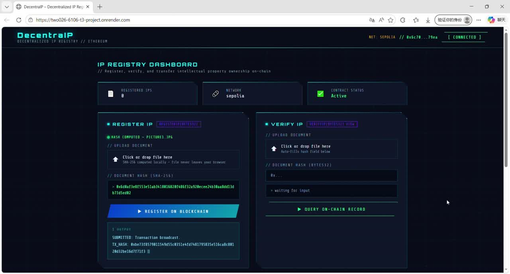

<div align="center">

# DecentraIP
### A document fingerprint registry on Ethereum

Register a document hash, inspect its on-chain record, and transfer the registry entry to another wallet — while keeping the document itself in your browser.


[Watch the demo](docs/media/demo.mp4) · [Architecture](docs/ARCHITECTURE.md) · [Smart contract](contracts/IPRegistry.sol) · [Tests](test/registry.test.cjs)

[](docs/media/demo.mp4)

</div>

## Overview

DecentraIP is a full-stack Web3 prototype built for the SC6106 Blockchain Development Fundamentals course. A static browser interface uses the Web Crypto API to hash a file locally and ethers.js to interact with a Solidity registry through an injected Ethereum wallet.

The registry stores a 32-byte document fingerprint, its current owner address, and the original registration timestamp. It never receives the file contents. An interactive comparison panel demonstrates how changing file bytes changes the SHA-256 fingerprint.

## Features

| Feature | Implementation |
| --- | --- |
| Local document fingerprinting | SHA-256 via `crypto.subtle.digest`; file bytes stay in the browser |
| On-chain registration | One record per nonzero hash; duplicate registrations revert |
| Record verification | Read the current owner, original timestamp, and existence flag |
| Ownership transfer | Only the record owner can transfer; zero-address and self-transfers revert |
| Transaction feedback | Wallet confirmation, broadcast transaction hash, and mined block number |
| Wallet configuration | Explicit contract address and chain ID; checks for deployed bytecode |
| Event-based integration | Indexed `IPRegistered` and `OwnershipTransferred` events |
| Hash comparison | Compare the fingerprints of two uploaded files without a wallet |

## Demo

**[Watch the full two-minute recording →](docs/media/demo.mp4)**

The supplied recording shows the original dashboard and wallet workflow. The repository includes an optimized H.264/AAC copy with the full recording duration preserved, plus a screenshot preview. Serve the project and open `/demo.html` for an embedded player. The recording predates the repository's configuration and status-display improvements.

## Quick start

### 1. Deploy the contract

Compile `contracts/IPRegistry.sol` with Solidity **0.8.20** and deploy `IPRegistry` using Remix or another Solidity deployment tool. No constructor arguments are required. Use a local EVM or an Ethereum testnet such as Sepolia, and note the deployed address and chain ID.

### 2. Configure the frontend

Edit `config.js`:

```javascript
window.DECENTRAIP_CONFIG = Object.freeze({
  contractAddress: "0xYOUR_DEPLOYED_CONTRACT_ADDRESS",
  chainId: 11155111 // Sepolia; use your deployment network's chain ID
});
```

The address is intentionally empty in the repository. No live deployment is assumed. The wallet network must match the configured chain, and the address must contain deployed contract code.

### 3. Serve the dashboard

```bash
git clone https://github.com/nullnulI/DecentraIP.git
cd DecentraIP
python3 -m http.server 8080
```

Open **http://localhost:8080**, then connect MetaMask or another compatible injected wallet. Upload a file to compute its fingerprint, register it, query that hash, and optionally transfer its registry entry to another wallet.

Use localhost or HTTPS: browser SHA-256 hashing requires a secure context. The frontend loads ethers.js and fonts from CDNs, so it needs internet access. No application backend, database, or document storage service is required.

### 4. Compile and test

Node.js 20+ is recommended for the development commands:

```bash
npm ci
npm run compile
npm test
```

Compilation writes an ABI/bytecode artifact to `artifacts/IPRegistry.json`. The tests compile the actual contract, deploy it to an in-process Ganache EVM, and exercise registration, verification, transfer authorization, invalid inputs, events, and timestamp preservation. No wallet, private key, or public RPC endpoint is needed for the tests.

## Contract interface

| Function | Behavior |
| --- | --- |
| `registerIP(bytes32 documentHash)` | Register a nonzero, previously unseen hash for `msg.sender` |
| `verifyIP(bytes32 documentHash)` | Return `(owner, registeredAt, exists)`; an unregistered nonzero hash returns zero values and `false` |
| `transferOwnership(bytes32 documentHash, address newOwner)` | Transfer the record to a different, nonzero address; preserve the original timestamp |

Events: `IPRegistered(documentHash, owner, timestamp)` and `OwnershipTransferred(documentHash, previousOwner, newOwner)`.

## Repository layout

| Path | Purpose |
| --- | --- |
| `contracts/IPRegistry.sol` | Solidity registry contract |
| `index.html` | Dashboard, hashing, wallet interaction, and transaction UI |
| `config.js` | Deployment address and network configuration |
| `demo.html` | Standalone demo video player |
| `docs/media/` | Full demo recording and preview image |
| `docs/ARCHITECTURE.md` | Data flow, storage model, and design boundaries |
| `scripts/compile.cjs` | Reproducible Solidity compilation |
| `test/registry.test.cjs` | Local EVM contract tests |

## Design boundaries

A registry entry is evidence of an address registering particular file bytes at a blockchain timestamp. It does **not** prove authorship, legal title, or copyright validity. Anyone who knows an unregistered hash can register it first; the prototype does not include identity verification, dispute resolution, or protection against registration front-running.

Document contents are not uploaded, but hashes, owner addresses, and timestamps are public. Byte-level hashing treats formatting changes as a different document. Block timestamps are chain metadata rather than certified wall-clock timestamps. The prototype has not undergone an independent security audit.

## Potential extensions

- Commit–reveal registration to reduce hash front-running exposure.
- Event indexing for registration history and current-wallet ownership lists.
- Signature-based creator attestations and identity or dispute workflows.
- Two-step ownership transfers with recipient acceptance.

These are proposed extensions, not implemented features.
