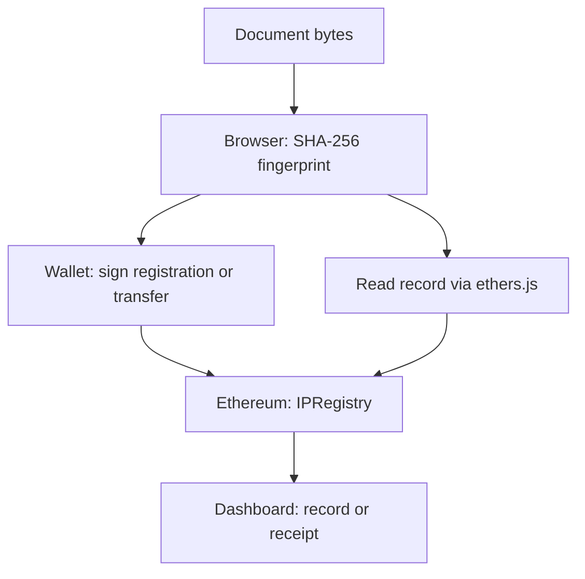

# Architecture

DecentraIP uses a static frontend and an Ethereum smart contract. The user's file is processed locally; only its 32-byte SHA-256 fingerprint enters the registry.

## Storage model

`mapping(bytes32 => IPRecord)` maps each document fingerprint to `{ owner, registeredAt, exists }`. Registration rejects zero hashes and existing entries. A transfer changes only `owner`, leaving `registeredAt` intact. The contract has no administrator, deletion function, fee logic, or external contract calls.

The mapping key is not stored as an additional struct field. In the current field order, `address`, `uint256`, and `bool` occupy three struct storage slots; the owner and existence flag are not packed together. State size grows with the number of distinct registered hashes. Querying by a known hash avoids scanning the registry.

## Workflow

1. Select a file. Web Crypto hashes its bytes in the browser.
2. Connect a wallet. The interface validates the configured chain ID and checks that the deployment address contains bytecode. This is a deployment sanity check, not contract identity verification.
3. Register. The wallet submits `registerIP(hash)`. The dashboard distinguishes wallet approval, transaction broadcast, and a mined receipt.
4. Verify. `verifyIP(hash)` reads the owner, original timestamp, and existence flag. The current UI uses the connected wallet provider, although the Solidity read itself does not require a signed transaction.
5. Transfer. The current record owner signs `transferOwnership(hash, newOwner)`. Other senders, the zero address, and self-transfers are rejected.

Account or chain changes clear the connected session and require reconnection. The dashboard counter counts successful registrations in the current connected session; it is not a historical balance or a global registry count.

## Trust and privacy

The frontend never intentionally sends file bytes to the chain or an application backend. Wallet RPC requests contain the hash and transaction data. Public registry metadata can reveal document membership when another party already possesses or guesses the same bytes. Third-party frontend dependencies are loaded from CDNs.

Registry ownership is an application-level record, not a legal IP determination. The first successful registration wins. There is no adjudication mechanism or creator identity proof. See the README for limitations and proposed extensions.
